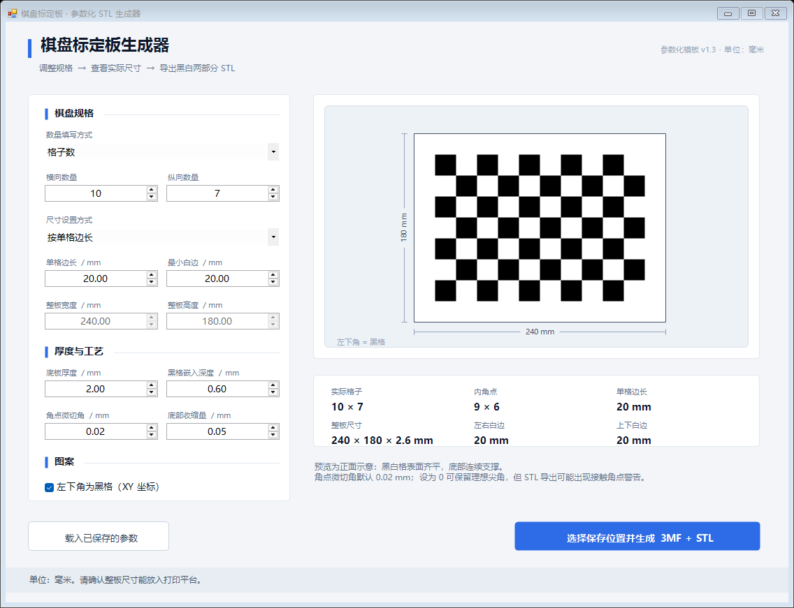

# CheckerCalib

> 棋盘标定板参数化模板 · Parametric Dual-Color Checkerboard Calibration Board Generator

  

参数化生成**相机标定用双色棋盘格**的本地工具：填几个数字，一键导出可直接投入拓竹 Bambu Studio 的单零件双色 3MF（黑白部件已分别指定挤出机），以及适配任意切片软件的黑白双 STL。无需联网，无需安装任何环境，单位毫米。



## 功能特性

- **参数化**：按格子数或内角点数输入；按单格边长或整板宽高定尺寸（保持正方形格子，多余空间自动变成白边）
- **双色同平面**：白色连续底板 + 黑色嵌入式格片，顶面齐平无台阶，面向 AMS / 多材料一次打印成型
- **单零件双色 3MF**：一个零件、两个部件，白色底板=挤出机 1、黑色格片=挤出机 2，并内嵌双色工程配置；Bambu Studio / OrcaSlicer 打开即用，无需再导入拼合
- **通用 STL**：同时导出 `white.stl` + `black.stl`，适配 PrusaSlicer 等其他切片软件的多零件流程
- **网格可打印**：黑格四角默认 0.02 mm 微切角 + 底部 0.05 mm 收量，规避数学棋盘的非流形角点，产出可切片的封闭网格；直边仍落在理论网格线上
- **免安装**：自带参数窗口与官方 OpenSCAD 2021.01 便携引擎；另有可单独分享的单文件版 exe（见下）
- **可复现**：每次导出同时保存参数 JSON、规格说明与导出日志，方便复用与追溯

## 快速开始（Windows）

### 方式一：完整文件夹（本仓库）

1. 下载 / 克隆整个仓库（保留 `tools` 文件夹）。
2. 双击 `棋盘标定板生成器.exe`（或 `双击启动生成器.cmd`）。
3. 调整规格 → 右侧实时显示实际格子数、内角点数、整板尺寸与尺寸标注预览。
4. 点「选择保存位置并生成 3MF + STL」，得到一个规格子文件夹。

### 方式二：单文件版 exe（分享给同事）

`棋盘标定板生成器_单文件版.exe`（约 21 MB）内嵌全部组件，**只需要这一个文件**：对方双击运行，首次自解压到 `%LOCALAPPDATA%\CheckerboardGenerator` 后打开窗口，无需安装任何软件。该文件体积较大，建议放在 GitHub **Releases** 而不是仓库内；本地可用 `打包工具\build_standalone.ps1` 随时重新生成。

### 方式三：直接用 OpenSCAD / MakerWorld

只想改模型不想跑窗口：用 [OpenSCAD](https://openscad.org/) 打开 `checkerboard.scad`（或粘贴到 [MakerWorld 参数化建模](https://makerworld.com/zh/makerlab/parametricModelMaker)），在自定义参数面板调数值，把 `export_part` 分别设为 `white` / `black` 各导出一次 STL。`checkerboard.json` 内置四个常用预设。

## 拓竹 Bambu Studio 打印流程

1. 打开或拖入生成的 `棋盘_xxx.3mf`——一个零件、两个部件：**白色底板=挤出机 1，黑色格片=挤出机 2**。
2. 切片前在左侧耗材列表确认槽位颜色：**1 号设为白色、2 号设为黑色**（对应 AMS 槽位）。
3. 直接切片打印。两个部件坐标已对齐，不要单独移动其中一个部件。
4. 没有 AMS / 多路的机器请改用换料打印或分件打印（黑白为嵌件结构，无法靠中途换色得到该图案）。

## 参数说明

| 参数 | 含义 |
| --- | --- |
| `count_mode` | 按格子数（`squares`）或内角点数（`inner_corners`）输入行列 |
| `columns` / `rows` | 横向 / 纵向数量，含义由 `count_mode` 决定 |
| `size_mode` | 按单格边长（`square`）或整板宽高（`outer`，保持格子正方形） |
| `square_size` | 单格边长 mm，仅 `square` 模式生效 |
| `border` | 四周最小白边 mm，必须大于 0 |
| `outer_width` / `outer_height` | 整板宽 / 高 mm，仅 `outer` 模式生效 |
| `base_thickness` | 白色连续底板厚度 mm |
| `pattern_thickness` | 黑格嵌入深度 mm（整板厚 = 底板 + 此值） |
| `inlay_taper` | 黑格底部内缩量 mm，默认 0.05，不改变顶面直边位置 |
| `corner_relief` | 黑格顶面四角微切角 mm，默认 0.02；设 0 可得理想尖角但导出会有非流形警告 |
| `black_at_origin` | XY 坐标左下角是否为黑格 |
| `export_part` | `preview` 黑白预览 / `white` 白色件 / `black` 黑色件 / `solid` 整板实体 |

内置预设（`checkerboard.json`）：默认 10×7 @20 mm（240×180）、紧凑 @15 mm、大格 @30 mm、整板 220×180。

## 每次导出得到什么

```
棋盘_10x7_单格20mm_时间戳/
├── 棋盘_10x7_单格20mm.3mf   # 单零件双色，Bambu Studio 直接打开（推荐）
├── white.stl                # 白色底板（连续实体）
├── black.stl                # 黑色格片（独立嵌件集）
├── checkerboard.json        # 本次参数，可再次载入
├── checkerboard.scad        # 模型模板副本
├── 规格说明.txt              # 尺寸、内角点数、使用要点
└── 导出日志.txt              # OpenSCAD 输出记录
```

示例成品见 [`示例_10x7_20mm/`](示例_10x7_20mm)（10×7 格、单格 20 mm、整板 240×180×2.6 mm、内角点 9×6）。

## 打印与标定精度建议

- 模型尺寸 ≠ 成品尺寸：使用前实测多个格子的总跨度后除以格数，并检查板面平整度与黑白边界质量。
- 默认参数面向多材料同次打印，未为分件拼装预留配合公差。
- 高精度标定建议使用经过计量的专业平面靶；本模板适合快速制作日常标定板。

## 项目结构

```
├── checkerboard.scad            # 参数化模型（唯一几何源）
├── generator.ps1                # 参数窗口 + STL/3MF 生成（可编辑）
├── bambu_project_settings.json  # 3MF 内嵌的双色工程配置
├── checkerboard.json            # 四个常用尺寸预设
├── 棋盘标定板生成器.exe           # 文件夹版启动器（调用 generator.ps1）
├── 双击启动生成器.cmd             # 备用启动入口
├── 打包工具/                     # 单文件版 exe 的打包脚本与资源
├── 示例_10x7_20mm/              # 实际导出的默认规格成品
├── 生成器预览.png                 # 界面截图
├── 使用说明.md                   # 详细使用文档
├── 验证结果.txt                  # 全部验证记录
└── tools/                       # 官方 OpenSCAD 2021.01 便携版（含原始许可）
```

## 验证情况（摘要）

完整记录见 [`验证结果.txt`](验证结果.txt)，全部为本机实测：

- 默认规格 STL 外形 240×180×2.6 mm；白色为 1 个连续实体、1132 面，黑色为 35 个独立嵌件、980 面；黑白体积之和与整板体积相符；网格封闭、每边恰好两面共用。
- 3MF 经 Bambu Studio 02.08 命令行实际载入并重新导出：两个部件、面数与挤出机映射（1=白 / 2=黑）完整保留。
- 无效规格（整板小于两侧白边）被模型断言与窗口双重拦截。
- 单文件版 exe 在空目录隔离测试中通过完整自检与真实导出。
- 未验证项：实体打印与相机标定实验；MakerWorld 在线导入。

## 从源码重新打包

修改 `generator.ps1` 后，右键「使用 PowerShell 运行」`打包工具\build_standalone.ps1` 即可重新生成单文件版 exe（使用 Windows 自带 .NET 编译器，离线可用；同步修改 `LauncherStandalone.cs` 中的版本号可触发客户端重新解压）。

## 贡献与致谢

- 模型引擎为官方 [OpenSCAD](https://openscad.org/) 2021.01 便携版，遵循其原始许可（GPLv2 等，详见 `tools/` 内各许可文件与 `tools/来源说明.txt`）；再分发本仓库即包含 OpenSCAD 二进制，请保留许可文件与[源码获取途径](https://files.openscad.org/2021.01/openscad-2021.01.src.tar.gz)。
- 3MF 采用 Bambu Studio 兼容的部件结构（外部对象文件 + 组件引用 + `model_settings.config` 部件表）。
- 本模板自身的代码与文档尚未声明许可证，如需公开发布请自行添加 LICENSE 文件。

---

模板版本 1.3 · 2026-11-18 · 单位：毫米
